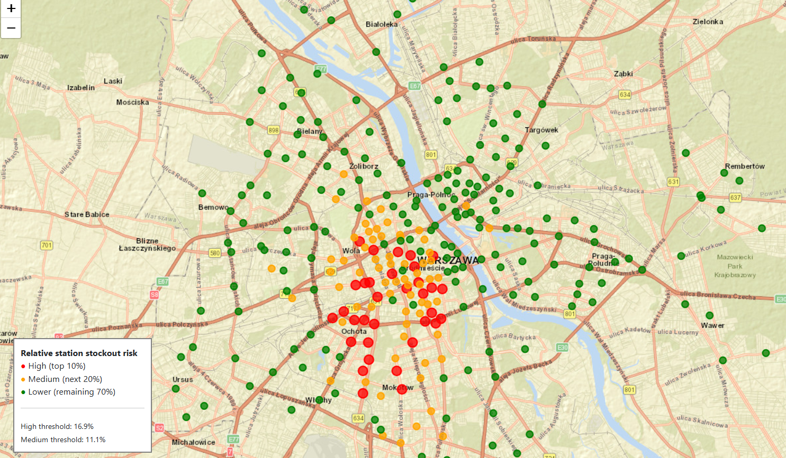
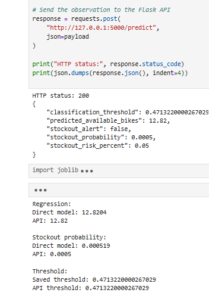

# Where Have All the Bikes Gone?
## Predicting Urban Bike-Sharing Demand and Detecting Mobility Deserts in Warsaw

## Project Overview

This project analyses Warsaw's bike-sharing system to forecast station-level bicycle availability and identify locations at elevated risk of stockouts.

Using historical bike availability snapshots collected between May and November 2023, the project develops two machine learning models:

1. **Bike availability regression:** predicts the average number of available bikes at a station one hour ahead.
2. **Stockout classification:** estimates the likelihood that a station will experience at least one zero-bike observation during the next hour.

The predictions are combined with geographical station data to create an interactive map of relative stockout-risk hotspots across Warsaw.

The broader objective is to explore how machine learning and spatial analysis can support bicycle redistribution, improve service reliability, and help identify potential gaps in urban micromobility access.

## Project Objectives

- Explore historical bike-sharing availability across Warsaw.
- Aggregate five-minute station snapshots into hourly observations.
- Predict next-hour bike availability at station level.
- Identify stations at elevated risk of stockouts.
- Evaluate models using chronological training, validation, and test periods.
- Visualise station-level risk using an interactive geographical map.
- Identify potential locations for improved bicycle redistribution.
- Discuss the relationship between bike availability and urban mobility accessibility.

## Dataset

**Source:** Warsaw Bike-Sharing Stations Dataset (RAW) – Season 2023

- Provider: Mendeley Data
- DOI: [10.17632/pxp72h4wdg.1](https://doi.org/10.17632/pxp72h4wdg.1)
- Dataset: [Warsaw Bike-Sharing Stations Dataset](https://data.mendeley.com/datasets/pxp72h4wdg/1)
- Observation period: 6 May – 29 November 2023
- Snapshot frequency: Every 5 minutes
- Station metadata: Geographical coordinates and surrounding urban attributes
- Additional data: Weather observations and spatial information

The original station archive contains approximately 59,694 JSON snapshots. Due to its size, the archive was processed as a stream using 7-Zip, without extracting the entire archive to disk.

## Data Processing

The data engineering pipeline:

1. Reads JSON snapshots directly from the RAR archive using 7-Zip.
2. Retains records classified as `STATION`.
3. Aggregates observations into hourly station-level records.
4. Calculates average available bikes, minimum available bikes, stockout observations, and average free racks.
5. Stores the aggregated observations in an SQLite database.
6. Validates the resulting dataset and checks data completeness.
7. Filters incomplete station-hours for modelling.
8. Creates time-based features, including hour, weekday, month, and cyclical time encodings.
9. Joins station metadata where available.

### Processed Dataset Summary

| Description | Value |
|---|---:|
| Raw JSON snapshots processed | 59,694 |
| Station observations processed | 19,143,452 |
| Hourly station records | 1,595,502 |
| Unique stations in processed observations | 333 |
| Unique hours | 4,975 |
| Average available bikes | 8.14 |
| Station-hours with at least one stockout observation | 13.3% |

A stockout is defined as at least one five-minute observation with zero available bikes during an hour.

This definition does not establish that a customer attempted and failed to rent a bicycle. It is used as an indicator of potential availability problems.

### Processed Database

The repository includes the aggregated SQLite database:

`data/processed/bike_hourly.sqlite`

The database is approximately 203 MB. It is intended to be distributed using Git Large File Storage (Git LFS).

Including the processed database allows reviewers to run the modelling and spatial analysis workflow directly, without downloading and processing the original large RAR archive.

To reproduce the complete raw-data processing pipeline, download the original Mendeley dataset and run Notebook 01.

## Machine Learning Models

### 1. Bike Availability Prediction

**Model:** XGBoost Regressor

**Target:** Average number of available bikes at a station in the following hour.

The model uses current availability, minimum availability, free racks, stockout information, station coordinates, and time-related features.

A persistence baseline is used for comparison. It predicts that next-hour availability will equal current-hour availability.

Evaluation uses a chronological split, with the final 20% of unique timestamps reserved for testing.

#### Regression Results

| Model | MAE | RMSE | R² |
|---|---:|---:|---:|
| Persistence baseline | 0.7980 | 1.5212 | 0.8762 |
| XGBoost Regressor | 0.8505 | 1.4213 | 0.8919 |

XGBoost achieves a lower RMSE and higher R², but the persistence baseline has a lower MAE.

Therefore, XGBoost is not unambiguously better across all metrics. The baseline remains a strong benchmark for short-term bike availability prediction.

### 2. Stockout Risk Prediction

**Model:** XGBoost Classifier

**Target:** Whether at least one zero-bike observation occurs during the following hour.

The classification task is imbalanced, so class weighting is used during training.

The decision threshold is selected using a chronological validation period, rather than tuning against the final test set.

**Selected classification threshold: 0.4713**

#### Classification Results

| Metric | Result |
|---|---:|
| Precision (stockout) | 0.33 |
| Recall (stockout) | 0.85 |
| F1-score (stockout) | 0.47 |
| PR-AUC | 0.6336 |
| ROC-AUC | 0.978 |

#### Confusion Matrix

| | Predicted no stockout | Predicted stockout |
|---|---:|---:|
| Actual no stockout | 303,181 | 12,559 |
| Actual stockout | 1,077 | 6,065 |

The classifier identifies approximately 85% of observed stockout events, but its relatively low precision means that many alerts are false positives.

The model is therefore better suited to prioritising stations for monitoring than to automatically triggering redistribution.

The predicted probabilities should be interpreted as risk scores because independent probability calibration has not been established.

## Temporal Distribution Shift

Stockout prevalence varies considerably over the observation period.

| Month | Observed stockout rate |
|---|---:|
| May | 18.67% |
| June | 17.56% |
| July | 15.71% |
| August | 16.14% |
| September | 16.93% |
| October | 6.94% |
| November | 1.63% |

The training stockout prevalence was 16.08%, validation prevalence was 12.33%, and test prevalence was 2.21%.

This substantial change indicates temporal distribution shift.

Model performance and alert precision may change as demand and operational conditions change throughout the year. The observed seasonal differences cannot be attributed to a specific cause using this dataset alone.

## Geographical Analysis

An interactive Folium map displays station-level predicted stockout risk across Warsaw.

The map uses Esri World Street Map tiles and includes:

- Station locations.
- Average predicted stockout risk.
- Predicted stockout rate.
- Actual stockout rate during the test period.
- Number of test observations per station.

Stations are classified using relative risk percentiles:

- **Red:** Top 10% of stations by average predicted risk.
- **Orange:** Next 20%.
- **Green:** Remaining 70%.

These categories indicate relative risk within the analysed stations, not absolute operational thresholds.

### Interactive Stockout-Risk Map

Red markers represent the highest relative-risk stations, orange markers indicate elevated relative risk, and green markers represent the remaining stations.



[Open the interactive Warsaw stockout-risk map](data/processed/warsaw_stockout_risk_map.html)

The map provides a geographical perspective on potential stockout hotspots and can help identify stations that may benefit from closer monitoring.

The risk rankings are based on the available test-period predictions and should not be interpreted as proof of persistent mobility deserts.

## Example Station-Level Predictions

The modelling workflow also produces a table of 15 Warsaw stations ranked by predicted stockout risk.

For each station, the results include:

- Predicted stockout risk.
- Forecast average bike availability for the following hour.
- Predicted stockout alert.
- Actual stockout frequency during the test period, where available.

These predictions demonstrate how model outputs can be translated into station-level operational insights.

## Project Structure

```text
warsaw_bike_demand/
│
├── data/
│   ├── raw/                          # Download separately
│   │   ├── stations.rar
│   │   ├── bike_stations_with_attributes.geojson
│   │   ├── weather_data.csv
│   │   └── ...
│   │
│   └── processed/
│       ├── bike_hourly.sqlite
│       ├── warsaw_stockout_risk_map.html
│       └── top_15_station_risks.csv
│
├── models/
│   └── warsaw_bike_models.joblib
│
├── notebooks/
│   ├── 01_data_engineering.ipynb
│   └── 02_modeling_and_spatial_analysis.ipynb
│
├── images/
│   └── warsaw_stockout_risk_map_demo.png
│
├── .gitattributes
├── .gitignore
├── requirements.txt
└── README.md
```

The original raw dataset is not included in the repository because of its size. It must be downloaded separately from Mendeley Data if you want to reproduce the complete data engineering pipeline.

The processed SQLite database and trained model artifact are provided to make the modelling workflow easier to reproduce.

## Installation and Prerequisites

### Requirements

- Python 3.12
- 7-Zip (required only for processing the original RAR archive)
- Jupyter Notebook
- SQLite (available through Python's built-in `sqlite3` module)
- Git LFS (required to retrieve the SQLite database from this repository)

### Setup

Clone the repository:

```bash
git clone <YOUR_GITHUB_REPOSITORY_URL>
cd warsaw_bike_demand
```

Install and initialise Git LFS if it is not already installed:

```bash
git lfs install
git lfs pull
```

Create a virtual environment:

```bash
python -m venv .venv
```

Activate it on Windows:

```bash
.venv\Scripts\activate
```

Install dependencies:

```bash
pip install -r requirements.txt
```

### Data Preparation

The processed SQLite database should be available at:

`data/processed/bike_hourly.sqlite`

If you want to reproduce the original data-processing pipeline, download the dataset from:

[Warsaw Bike-Sharing Stations Dataset – Mendeley Data](https://data.mendeley.com/datasets/pxp72h4wdg/1)

Place the downloaded raw files in `data/raw/`.

Install 7-Zip if you intend to reproduce the original archive-processing pipeline. The pipeline streams the archive contents without extracting all JSON files to disk.

### Running the Notebooks

For the quickest reproduction of the modelling results, open and run:

**Notebook 02 — `02_modeling_and_spatial_analysis.ipynb`**

It uses the provided SQLite database and:

- Loads the processed station-hour observations.
- Performs feature engineering.
- Trains and evaluates regression and classification models.
- Generates station-level predictions.
- Creates the interactive stockout-risk map.

To reproduce the complete workflow from the original raw data, run the notebooks in this order:

1. **`01_data_engineering.ipynb`**
   - Processes the original snapshots.
   - Creates and validates the SQLite database.
   - Performs data exploration and aggregation.

2. **`02_modeling_and_spatial_analysis.ipynb`**
   - Loads the processed SQLite database.
   - Performs feature engineering.
   - Trains and evaluates regression and classification models.
   - Generates station-level predictions.
   - Creates the interactive stockout-risk map.

The original archive-processing step is computationally intensive and took approximately 74 minutes in the development environment.

## Loading Saved Models

The trained models and their configuration are stored in:

`models/warsaw_bike_models.joblib`

Load them using:

```python
import joblib
from pathlib import Path

PROJECT_DIR = Path.cwd()

if PROJECT_DIR.name == "notebooks":
    PROJECT_DIR = PROJECT_DIR.parent

artifacts = joblib.load(
    PROJECT_DIR / "models" / "warsaw_bike_models.joblib"
)

regression_model = artifacts["regression_model"]
stockout_classifier = artifacts["stockout_classifier"]
stockout_threshold = artifacts["stockout_threshold"]
```

For predictions, the input data must contain the same features, in the same order, and use the same preprocessing as during model training.
## Model API Testing

The trained regression and classification models are served through a Flask REST API implemented in `predict.py`.

The API exposes a `/predict` endpoint that accepts JSON input containing the engineered features required by both models and returns:

- **Predicted available bikes:** estimated number of bikes available during the next hour.
- **Stockout probability:** probability of observing a stockout during the next hour.
- **Stockout risk percentage:** stockout probability expressed as a percentage.
- **Stockout alert:** binary alert based on the validation-selected classification threshold.
- **Classification threshold:** the threshold used to generate stockout alerts.

### Testing methodology

The API was tested using a genuine observation from the chronological test datasets (`X_test` and `X_test_cls`) created during model evaluation.

The API predictions were compared against predictions generated directly by the saved models in the Jupyter Notebook. This verified that the API loads the correct model artifacts, processes input features correctly, and returns consistent predictions.

### Test results

| Metric | Direct model | Flask API |
|---|---:|---:|
| Predicted available bikes | 12.8204 | 12.82 |
| Stockout probability | 0.000519 | 0.0005 |
| Classification threshold | 0.471322 | 0.471322 |

**Result:** The API predictions matched the direct model predictions, with minor differences caused by output rounding.

The test returned HTTP status `200`, confirming successful request processing.



### Running the API locally

Install the required dependencies:

```bash
pip install flask pandas numpy joblib xgboost
```

Start the API:

```bash
python predict.py
```

The API is available at:

```text
http://127.0.0.1:5000
```

Available endpoints:

| Method | Endpoint | Description |
|---|---|---|
| GET | `/` | API information |
| GET | `/health` | Health check |
| POST | `/predict` | Generate bike availability and stockout predictions |

### API scope and limitations

The current API accepts pre-engineered numerical features rather than raw station IDs or timestamps. It does not independently retrieve live bike-sharing data, calculate features, or connect to a real-time Warsaw bike-sharing service.

The API is therefore a model-serving demonstration rather than a live operational bike-sharing prediction system.
## Limitations

- The dataset covers one season of 2023, so the results do not establish year-round performance.
- Stockout observations do not prove that customers were unable to rent a bike.
- The test period has substantially lower stockout prevalence than the training period.
- Stockout probabilities have not been independently calibrated.
- The classifier produces a considerable number of false alerts.
- Station-level risk rankings are not proof of persistent mobility deserts.
- Geographical coverage gaps are inferential and require additional analysis of population, trip demand, and walking distances.
- Historical predictions do not constitute a live operational forecasting service.
- Station metadata is not available for every station in the processed observations.

## Future Improvements

- Incorporate historical trip origins and destinations to estimate actual demand.
- Assign weather observations to stations using spatial proximity.
- Test seasonal and rolling-window validation strategies.
- Evaluate probability calibration and alternative classification thresholds.
- Explore station-level and neighbourhood-level demand forecasting.
- Develop a bicycle redistribution recommendation system.
- Investigate spatial accessibility and potential micromobility coverage gaps.
- Evaluate models on additional years of data.

## Conclusion

This project demonstrates how historical bike-sharing availability data can be used to forecast station-level supply and identify potential stockout hotspots.

The regression model provides useful next-hour availability estimates, while the classification model prioritises stations that may require attention. The interactive map translates model outputs into a geographical view that could support operational planning.

The results also demonstrate why temporal validation, class imbalance, and changing seasonal conditions must be considered when developing predictive systems for urban mobility.

Ultimately, the project provides a starting point for exploring how machine learning and spatial analysis can support more reliable and accessible urban bike-sharing services.

---

**Project:** ML Zoomcamp Capstone Project  
**Location:** Warsaw, Poland  
**Dataset period:** May–November 2023